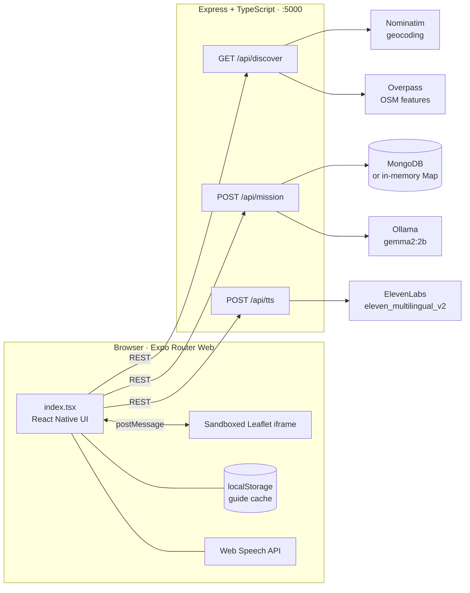

<div align="center">

# 🌿 adventure.ai

### Find a patch of green nearby, then leave your phone in your pocket.

A privacy-first, local-AI nature scout. It finds real parks, gardens, viewpoints and waterside trails near you, writes a **Screen-Free Field Guide** with a local open-weight model, and **reads it to you** so you can lock your screen and walk.

<br/>


<br/>

[](https://youtu.be/cz6mx_LrYaw)

**[▶ Watch the demo](https://youtu.be/cz6mx_LrYaw)** &nbsp;·&nbsp; **[Quick start](#-quick-start)** &nbsp;·&nbsp; **[How it works](#-how-it-works)** &nbsp;·&nbsp; **[API](#-api-reference)** &nbsp;·&nbsp; **[Contributing](#-contributing)**

</div>

---

## 💡 The idea

Apps that promise to get you outdoors usually need you to stare at a screen to use them. **adventure.ai** is built around the opposite goal: get you to put the phone away as fast as possible.

The whole flow takes about 30 seconds:

|        Step         | What happens                                                                                                                                         |
| :-----------------: | :--------------------------------------------------------------------------------------------------------------------------------------------------- |
|    **1. Start**     | Tap **📍 Find Around Me** (browser GPS) or search any city with **🔍 Explore City**.                                                                 |
|   **2. Discover**   | Parks, gardens, nature reserves, viewpoints, picnic sites, water, woods and peaks within **5 km** appear as pins on a Leaflet + Esri World Topo map. |
| **3. Pick a spot**  | A local **Gemma 2 (2B)** model writes your _Touch Grass Field Guide_.                                                                                |
| **4. Go eyes-free** | Press **🔊 Listen to Audio Briefing**, lock your phone, and walk.                                                                                    |

---

## ✨ Features

### 🗺️ Zero-key geospatial discovery

- Browser geolocation, or any city worldwide via **OpenStreetMap Nominatim**.
- **Overpass API** query for named outdoor features within a **5 km** radius, deduplicated, categorised and sorted by distance.
- Category filter pills: `All` · `Gardens & Parks` · `Viewpoints` · `Water & Trails`.
- If Overpass is slow or rate-limited, a **deterministic fallback generator** (seeded `mulberry32` PRNG) supplies plausible nearby spots so the demo never fails.

### 🧠 100% local AI field guides

Powered by **Gemma 2 2B** through **Ollama** in JSON mode. Every spot gets:

| Section                   | Description                                                                    |
| :------------------------ | :----------------------------------------------------------------------------- |
| 🌤️ **Vibe**               | One sentence on why to visit today                                             |
| 🥾 **Best Activity**      | The one thing worth doing there                                                |
| 🔎 **Nature Spotter**     | 3 local plants, trees or birds to look for                                     |
| ✅ **Screen-Free Quests** | 3 physical mini-challenges with checkboxes, done with the phone in your pocket |
| 🎙️ **Voice Script**       | A warm 3-sentence audio briefing                                               |

Small models drift, so every response is normalised: types are coerced and arrays are padded to exactly three items from a template guide.

### 🔊 Eyes-free audio briefing

**ElevenLabs** (`eleven_multilingual_v2`) narrates the guide when `ELEVENLABS_API_KEY` is set. Without it, or if the call fails, the app falls back to the browser's `speechSynthesis`, so the briefing always plays.

### 💾 Dual offline caching

Guides are cached in **MongoDB** (with an in-memory `Map` fallback) and in browser **`localStorage`**. A guide you've opened once loads instantly with no backend.

---

## 🏗️ How it works



### Mission request lifecycle

```mermaid
sequenceDiagram
    participant U as User
    participant F as Frontend
    participant B as Backend
    participant C as MongoDB / Map
    participant O as Ollama

    U->>F: Tap a spot
    F->>F: Check localStorage
    alt Found locally
        F-->>U: Show card instantly
    else Not found
        F->>B: POST /api/mission
        B->>C: Look up cached guide
        alt Cache hit
            C-->>B: Guide
        else Cache miss
            B->>O: Generate JSON guide
            O-->>B: Raw JSON
            B->>B: Normalise to exactly 3 + 3 items
            B->>C: Upsert guide
        end
        B-->>F: guide, cached, source
        F->>F: Save to localStorage
        F-->>U: Show Mission Card
    end
```



### Graceful degradation

Every external dependency has a fallback, so nothing breaks mid-demo.

| If this fails                                                | The app does this                                                 |
| :----------------------------------------------------------- | :---------------------------------------------------------------- |
| Overpass is slow, rate-limited or returns fewer than 6 spots | Fills in deterministic `mulberry32` spots around your coordinates |
| MongoDB isn't running                                        | Uses an in-memory `Map` on the server                             |
| Ollama isn't running                                         | Returns a clearly labelled starter guide (not cached)             |
| No ElevenLabs key, or the call fails                         | Reads the briefing with `window.speechSynthesis`                  |
| Browser blocks `localStorage`                                | Skips the client cache silently                                   |

### What works offline?

| Feature                          |               No signal               |
| :------------------------------- | :-----------------------------------: |
| Previously opened field guides   |                  ✅                   |
| Audio briefing via browser voice |                  ✅                   |
| Ticking off quests               |                  ✅                   |
| New city or spot discovery       |     ❌ needs Overpass / Nominatim     |
| Map tiles you haven't viewed     |          ❌ needs Esri tiles          |
| Generating a brand-new guide     | ✅ if Ollama runs on the same machine |

> **Intended pattern:** plan at the trailhead, then walk offline.

---

## 🧰 Tech stack

| Layer                | Technology                                                                    |
| :------------------- | :---------------------------------------------------------------------------- |
| **Frontend**         | React Native (Expo Router Web), TypeScript, Leaflet.js, Esri World Topo tiles |
| **Backend**          | Node.js, Express, TypeScript (`tsx`)                                          |
| **Local AI**         | Ollama running `gemma2:2b` in JSON mode                                       |
| **Database & cache** | MongoDB (driver) + in-memory `Map` + browser `localStorage`                   |
| **Geospatial data**  | OpenStreetMap Nominatim + Overpass API                                        |
| **Voice**            | ElevenLabs TTS + Web Speech API fallback                                      |
| **Infrastructure**   | Docker & Docker Compose                                                       |

---

## 📁 Project structure

```
adventure.ai/
├── backend/
│   └── src/
│       └── index.ts          # Express API: discover, mission, tts
├── frontend/
│   └── app/
│       └── (tabs)/
│           └── index.tsx     # Expo Router Web UI + Leaflet iframe bridge
└── docker-compose.yml        # MongoDB + Ollama (+ one-shot gemma2:2b pull)
```

---

## 🚀 Quick start

### Prerequisites

- **Node.js 18+** (the backend uses the built-in `fetch`)
- **Docker** with Docker Compose, _or_ a local Ollama and
